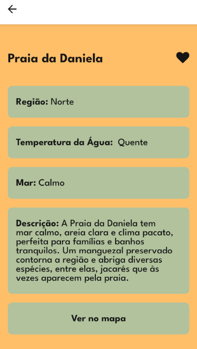
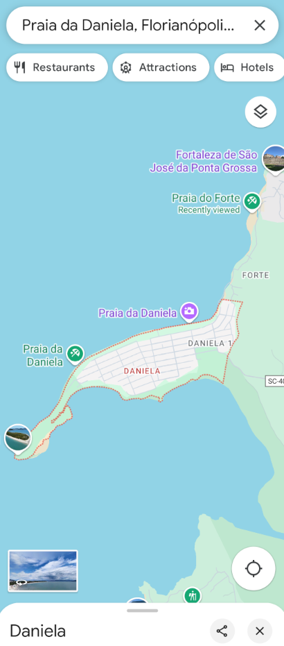
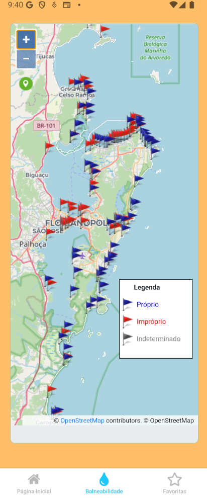

# 🌊 Achou, mané

Um aplicativo mobile que ajuda usuários indecisos a encontrar a praia perfeita em Florianópolis. Responda a um quiz rápido e receba recomendações personalizadas ou explore a balneabilidade das praias da região.

## Visão Geral

Aqui está um tour pelas principais telas e funcionalidades do aplicativo:

### 1. Página Inicial

A tela de boas-vindas, onde o usuário pode iniciar o quiz para encontrar uma praia.

### 2. Resultados Personalizados

Após o quiz, o aplicativo apresenta uma lista de praias recomendadas com base nas respostas do usuário. Há também a opção de sortear uma praia.

### 3. Detalhes da Praia

Ao clicar em uma praia na lista de resultados (ou na tela de favoritas), o usuário vê informações detalhadas sobre ela, como região, temperatura da água, tipo de mar, uma descrição e a possibilidade de favoritar uma praia.

### 4. Visualização no Mapa

A partir da tela de detalhes da praia, o usuário pode visualizar a localização da praia em um mapa externo para facilitar a navegação.

### 5. Balneabilidade

Uma aba dedicada que exibe informações atualizadas sobre a qualidade da água das praias de Santa Catarina, diretamente do site oficial.

### 6. Praias Favoritas

É possível salvar praias preferidas para acesso rápido a qualquer momento nesta seção.

## 🛠️ Tecnologias Utilizadas

-   React Native

-   Firebase
    
-   Expo
    
-   Expo Router
    
-   Zustand
   
